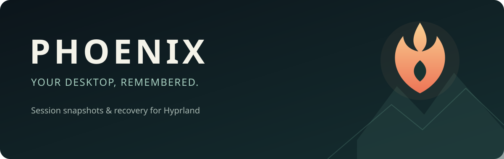

<p align="center"></p>

<p align="center"><strong>Локальные снимки и восстановление сессии Hyprland.</strong><br>Открой компьютер — и вернись к тому, на чём остановился.</p>

<p align="center"><a href="#быстрый-старт">Быстрый старт</a> · <a href="#как-это-работает">Как это работает</a> · <a href="#интерфейс">Интерфейс</a> · <a href="#безопасность-и-приватность">Приватность</a> · <a href="#ограничения">Ограничения</a></p>

---

Phoenix запоминает открытые окна и рабочие столы, а после нового входа предлагает восстановить сессию. Историю можно просмотреть как ленту рабочих столов: выбрать сохранение, пролистать экраны и решить, что вернуть.

> **Phoenix 1.1 alpha.** При первом запуске схема базы обновляется; код версии 1.0 не откроет схему 5. Перед миграцией автоматически создаётся отдельная проверенная копия схемы 4; остановите старый daemon. [Миграция и возврат](docs/kitty.md#миграция-и-возврат-на-10).
>
> **Статус: ранняя версия.** Проект проверен в Omarchy / Hyprland; восстановление зависит от установленных приложений и их desktop-файлов. Phoenix не сохраняет память процессов и не является заменой гибернации или CRIU.

## Возможности

- **Снимки сессии** — автоматически раз в 60 секунд и вручную; SQLite, проверка целостности и ротация истории.
- **Визуальная история** — сжатые кадры видимых рабочих столов, автоматический захват при переходе и плавная карусель.
- **Восстановление окон** — поиск уже открытых приложений, безопасный запуск отсутствующих, рабочие столы и доступные параметры окон.
- **Kitty** — опциональный сбор вкладок, панелей и рабочих каталогов через приватный сокет. Scrollback архивируется только после отдельного включения. [Настройка и ограничения](docs/kitty.md).
- **Контроль истории** — закрепление и удаление снимков, настройка количества автоснимков и отключение записи изображений.
- **Резервные копии** — проверенная локальная копия SQLite раз в сутки при работающем сборщике; хранятся три последние копии.
- **Локально и без root** — личные данные остаются на устройстве; телеметрии нет.

## Быстрый старт

Потребуются Python **3.11+**, Hyprland **0.55+**, `hyprctl`, `gio`, GTK4, PyGObject и Pycairo с GI-интеграцией. Для изображений нужны `grim`, ImageMagick (`magick`) и `loginctl`. Зависимости интерфейса должны быть доступны системному Python.

```bash
git clone https://github.com/6axam/Phoenix.git
cd Phoenix
./phoenix.sh doctor
./phoenix.sh snapshot --name "Первый снимок"
./phoenix.sh gui
```

Для периодического сохранения запустите сборщик в графической сессии:

```bash
./phoenix.sh daemon
```

Он работает до остановки или окончания сессии. При наличии истории в новом экземпляре Hyprland Phoenix предложит восстановление; до решения пользователя автоматические снимки приостановлены. Проект самостоятельно не включает автозапуск. Пример user unit находится в [`examples/`](examples/).

## Как это работает

| Действие | Команда |
| --- | --- |
| Состояние и целостность | `./phoenix.sh status` |
| Ручной снимок | `./phoenix.sh snapshot --name "Работа"` |
| История | `./phoenix.sh history` |
| Просмотр данных снимка | `./phoenix.sh inspect latest` |
| План без изменений | `./phoenix.sh restore latest --dry-run` |
| Восстановление | `./phoenix.sh restore latest --safe` |
| Резервная копия | `./phoenix.sh backup` |
| Графический интерфейс | `./phoenix.sh gui` |
| Архив терминала | `./phoenix.sh archive list latest` |
| Журнал восстановления | `./phoenix.sh recovery-log latest` |

Вместо `latest` можно указать номер снимка. Phoenix не закрывает открытые окна и не исполняет команды, сохранённые в снимке. Неоднозначный запуск после таймаута автоматически не повторяется.

Если пользовательское приложение не находится автоматически, можно явно доверить **конкретному** desktop-файлу:

```bash
./phoenix.sh trust-desktop /полный/путь/к/приложению.desktop
```

Phoenix запоминает отпечаток файла; после его изменения доверие нужно установить заново. Проверка desktop-файла не гарантирует неизменность запускаемой им программы.

## Интерфейс

Верхний список выбирает сохранение. Колёсико, стрелки и боковые экраны перелистывают **рабочие столы внутри него**. Раздел «Приложения» позволяет выбрать компоненты восстановления. Снимки можно закрепить или удалить; настройки регулируют число автоснимков, интервал и запись изображений.

🟢 **Кадр снимка** — изображение получено при создании выбранного сохранения.  
🟠 **Более ранний кадр** — последняя доступная картинка этого стола до сохранения; время указано рядом.  
⚪ **Схема окон** — изображения нет, показано приблизительное расположение по метаданным.

При переключении Hyprland сообщает о новом рабочем столе уже после перехода. Phoenix снимает его после короткой паузы; при быстром перелистывании промежуточные столы могут быть пропущены. Ранее сохранённый кадр может отличаться от состояния на момент снимка.

## Безопасность и приватность

Изображения могут содержать всё видимое на экране: переписку, документы и другие личные данные. Они хранятся **локально, без шифрования**, в каталоге пользователя. При блокировке сеанса и видимом исключённом приложении соответствующий экран не снимается; это проверка best-effort. Выключение изображений не удаляет уже сохранённые кадры и резервные копии.

История команд и переменные окружения не собираются. Содержимое терминала архивируется только при отдельном opt-in и может содержать секреты. Сеть не используется. Настройка исключений в `~/.config/phoenix/config.json`:

```json
{
  "exclude_classes": ["org.example.Private"],
  "capture_previews": true,
  "snapshot_retention": 60,
  "interval_seconds": 60
}
```

[Подробнее о безопасности](docs/security.md) · [Как устроено восстановление](docs/recovery.md)

## Ограничения

Вкладки и панели Kitty восстанавливаются best-effort при однозначном сопоставлении каждого OS-окна с отдельным процессом и настроенным сокетом; процессы и точная геометрия splits не восстанавливаются. tmux, SSH, каталоги файлового менеджера и проект Codex не восстанавливаются специализированно. Восстановление вкладок браузера зависит от самого браузера. Tiled-геометрию определяет раскладка Hyprland. Резервные копии не восстанавливаются автоматически при повреждении основной базы.

[Полный список ограничений](docs/limitations.md) · [Архитектура](docs/architecture.md) · [Тестирование](docs/testing.md)

## Разработка

```bash
python3 -m venv .venv
.venv/bin/python -m pip install pytest
.venv/bin/python -m pytest -q
```

Тесты используют временные базы и имитацию Hyprland; перезагрузка не требуется.

## Удаление

Остановите Phoenix. Если автозапуск добавлен вручную, удалите его запись из конфигурации Hyprland. Для полного удаления данных удалите каталоги `phoenix` в `~/.local/share/`, `~/.local/state/` и `~/.config/` (или соответствующих XDG-каталогах), затем удалите репозиторий.
